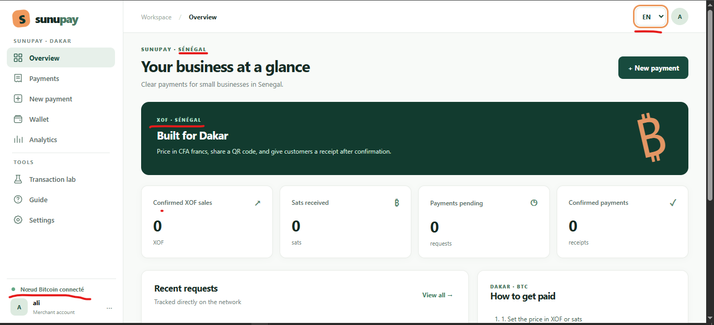
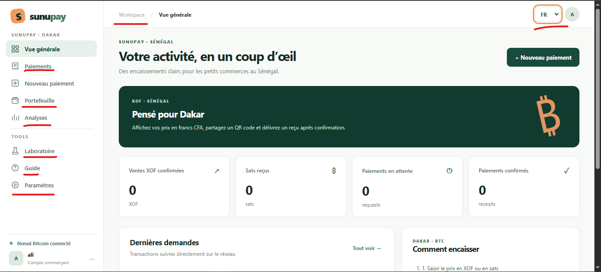
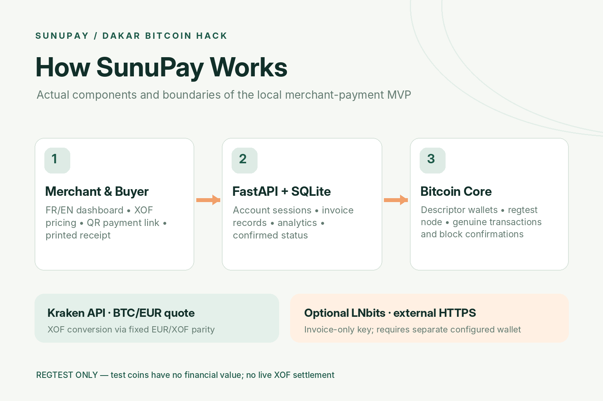

# SunuPay — Merchant Payments for Senegal

A low-bandwidth, bilingual merchant checkout for Senegal's small businesses. Merchants can **price a sale in CFA francs (XOF)**, generate a Bitcoin payment request, share the QR code, verify whether payment was actually received and give a printable receipt. **This is a working local Bitcoin Core regtest application; regtest BTC has no monetary value.** Optional Lightning reception uses a separately configured external LNbits wallet, which may involve real funds.

## What merchants can do

| Area | Working implementation | Limit |
| --- | --- | --- |
| Bitcoin wallet | Genuine Bitcoin Core v28 descriptor wallets per merchant, RPC-funded and mined on a private regtest chain | Not mainnet/testnet funds |
| XOF checkout | Fetches Kraken public BTC/EUR ticker; converts with BCEAO's fixed `655.957 XOF/EUR` rate; rounds upward to whole sats; locks the exchange-rate snapshot on creation | Indicative price only; no XOF payout, no offline fallback invented |
| Satoshi checkout | Direct satoshi amount without any external pricing API | Minimum 1,000 sats |
| Lightning invoices | Real LNbits `POST /api/v1/payments` using an invoice-only key; checks `GET /api/v1/payments/{checking_id}` before marking paid | **Disabled until explicitly configured**. External Lightning wallet separate from regtest; real funds possible. One shared provider wallet per deployment (single merchant) |
| Public checkout | Unique unguessable payment link, real on-chain address or BOLT11 invoice, generated QR, live payment status | Public token can be shared; it reveals title and requested amount |
| Receipts | Server-generated, printable **HTML receipt** only after a verifiable paid status; browser can save as PDF | No provider-signed fiscal invoice or tax compliance guarantees |
| Business profile | Saved shop name, city and language, displayed on receipts | Not merchant identity verification |
| Analytics | 14-day confirmed transactions, merchant totals, invoice counts, XOF sales, paid per payment network | Figures only from *observed* confirmed invoices; XOF excludes sat-only invoices |
| Language | French and English for main merchant flows and public payment page | Wolof translation not currently included |
| Transactions | Persistent merchant wallets, customer regtest faucet, actual raw Bitcoin tx broadcast, block generation, CSV export | Offline/local setup, no real payment network deployment |

The project does **not** pretend to be a production custodian, telecom wallet integration, a bank, a mobile-money provider, or a CFA payout service. There is no AI chatbot or Nostr connector, because the core hackathon use case is working payment reception and traceability.

## Start on Windows with Docker Desktop

Prerequisites: Windows with Docker Desktop (Linux containers / WSL2), or Linux with Docker Engine and Compose V2. Use an up-to-date browser. An Internet connection is required for initial Docker image downloads and to create live XOF invoices. Docker needs roughly 2GB free disk space. **No domain, email delivery service, business email, Bitcoin seed or API key is required for on-chain regtest use.** Create a local account with your chosen email-formatted login and password.

From the `SunuPay` folder:

```powershell
docker compose up -d --build
docker compose ps
```

Visit **http://localhost:8000**. The merchant registration screen opens on first use. The Docker Compose file binds the web app to **127.0.0.1** only; external phones cannot connect unless you explicitly change its configuration.

**Updating an existing SunuPay installation:** extract the ZIP over the existing source code, **keep the same project folder and Compose project name**, and run the same `docker compose up -d --build` command. SQLite, merchant wallets and Bitcoin regtest blockchain live in named volumes and are preserved through normal rebuilds. Schema migrations add new invoice and merchant fields without deleting old records.

Never run `docker compose down -v` unless you intend to erase **all** local wallet and invoice data.

### Quick walkthrough: a Dakar merchant's sale

1. Sign in. Go to **Paramètres / Settings**, enter your business name (`Boulangerie Awa`, for example) and city `Dakar`.
2. Click **Nouveau paiement / New payment**, enter `Pain et café`, select **XOF** and enter a price like `2,500`. The app asks Kraken for **current** BTC/EUR, computes XOF/sats using the fixed euro-CFA parity and previews the satoshi amount.
3. Select **Bitcoin · regtest** and create the request. You now have a real Bitcoin Core receiving address, an invoice number and a QR/link for the customer. The network is local and valueless, but RPC calls and transactions are real.
4. Open **Laboratoire / Transaction lab**, add test sats to the isolated customer wallet, choose the unpaid on-chain invoice, and send a payment. Before a block confirmation it is shown as **Confirming**.
5. Click **Mine block** in the transaction lab. The invoice becomes **Paid** only after Core detects at least one confirmation.
6. Open the public checkout page or payment detail and print the receipt. Visit **Analyses / Analytics** for aggregate confirmed sales. Use **Export CSV** for bookkeeping records.

For Bitcoin Core proof:

```powershell
docker compose exec -u bitcoin bitcoin bitcoin-cli -regtest getblockchaininfo
docker compose logs --tail=60 bitcoin app
```

Note that XOF exchange quotes reflect the market price at invoice creation and may not equal what a real payer would receive from a crypto exchange including trading fees. **The app does not accept or disburse physical or electronic CFA francs.** If Kraken cannot be reached, **XOF invoice creation fails safely**; you can still choose SATS and test the Bitcoin Core flow without Internet.

## Optional real Lightning through LNbits

**Requires a real external LNbits service/wallet and invoice-only API key**. These credentials are *not included*, and Lightning is intentionally disabled by default. Follow the provider's security and wallet backup instructions before receiving real funds. For any real funds, a production security assessment is required. You are responsible for the external provider and Lightning liquidity.

1. Obtain `LNBITS_URL` (an HTTPS LNbits base address, e.g. `https://your-provider.example`) and `LNBITS_INVOICE_KEY` (the **invoice/receive-only key**, NOT admin/spend key).
2. Copy `.env.example` to `.env` in the SunuPay directory. Replace the two empty values with your actual LNbits URL and invoice-only key. Never commit `.env`.
3. Recreate the app service without deleting volumes:

```powershell
docker compose up -d --no-build --force-recreate
```

4. The **Lightning** option is now enabled. Creating a Lightning invoice makes a real LNbits API request and stores its BOLT11 invoice. Its status is checked against LNbits, and only a returned `paid: true` is shown as paid.

**Important custody limitation:** The Lightning adapter uses **one configured LNbits wallet shared by this SunuPay deployment**. Do not serve unrelated merchants using a shared external Lightning wallet, as their funds will be commingled. Use one separate SunuPay deployment and LNbits wallet per merchant, or develop separate per-merchant encrypted key storage and settlement logic before a multi-merchant launch. Bitcoin Core regtest wallets are isolated per user; Lightning funds are **not** held in those wallets. LNbits status failures are shown as **unavailable**, never falsely marked as paid.

**The LNbits provider is NOT bundled or automatically created** and may be mainnet, testnet or another Lightning configuration. SunuPay does not assume its network is regtest. LNbits Lightning payments are excluded from the Bitcoin regtest transaction lab.

## Architecture

```text
                          SunuPay web client (French / English)
                                       |
                           FastAPI (session authentication)
                                       |
                 +---------------------+--------------------+
                 |                     |                    |
              SQLite             Bitcoin Core          External HTTPS
            invoice/profile      v28 regtest node       +--------------+
                 |              descriptor wallets      | Kraken BTC/EUR|
           status/receipt             |                  | LNbits wallet |
           sales analytics     on-chain txs, QR          +--------------+
                               sign/send/mine              ^        ^
                                               XOF pricing only  LN optional
```

All main application assets are local (no remote fonts, CSS frameworks or CDN), optimized to work on mid-range devices and weak connections. XOF price retrieval and optional LNbits calls are the exceptions that require Internet.

## Security notes and product limitations

- The app is intended for a private local Docker environment. It is **not safe to expose publicly as a full custody service** without HTTPS, backup and recovery procedures, authorization and account policy hardening, payments lifecycle safeguards, abuse limits, monitoring and an independent security review.
- Only the invoice-only LNbits key is needed to **receive**, never the admin key. `.env` is gitignored and excluded from Docker build context; secrets are not returned to the browser.
- Invoice status always derives from the real Bitcoin node or configured LNbits server. Provider outage produces an unavailable status; no fake success responses are used in production.
- On-chain invoices are only private regtest BTC. Lightning is an external provider which might process real money. **Do not confuse these payment rails.**
- Receipt timestamps are the first time SunuPay observed a verified payment (UTC), **not** necessarily the blockchain settlement time. Existing pre-upgrade invoices use the first observation after upgrade. Charts group by this observation date.
- The app does not issue XOF currency balances, promise XOF conversion at redemption, or support merchant withdrawals to a bank/mobile-money account.
- Public token checkout is deliberately shareable and contains order description, amount and payment details. Do not put customer personal information in descriptions. Logs should not contain PII.
- For deployment and threat model, see `docs/SECURITY.md`.

## Tests

Tests isolate the RPC/HTTP boundary to verify API behavior without relying on a live server. **Test doubles exist only inside `tests/`, never in the shipped runtime.** All actual runtime calls use Bitcoin Core or LNbits.

```bash
python -m pip install -r requirements.txt -r requirements-dev.txt
PYTHONPATH=. pytest -q
```

Windows PowerShell:

```powershell
$env:PYTHONPATH='.'
pytest -q
```

The unit/API tests **do not** replace a live end-to-end Docker run. The user must confirm merchant registration, funding, block mining, invoice confirmation and optional LNbits payment on their own configured machine.

## Known operational issues

- **Bitcoin container unhealthy:** run `docker compose logs --tail=80 bitcoin` and `docker compose exec -u bitcoin bitcoin bitcoin-cli -regtest getblockchaininfo`. Health checks run as the `bitcoin` user so RPC cookie auth works.
- **Slow Python builds or missing PyPI package errors:** Docker may be unable to reach PyPI reliably. The Dockerfile uses a long timeout and BuildKit pip cache. Retry `docker compose --progress plain build`. Do not change pinned versions merely to bypass a transient network timeout.
- **Markets unavailable:** `XOF` creation requires a fresh public Kraken API rate. There is deliberately no stale/fake fallback. Switch to `SATS` when offline.
- **Lightning not offered:** add the `LNBITS_URL` and `LNBITS_INVOICE_KEY` secrets to `.env` and recreate the app. Remember the external provider and wallet are not included.
- **Old HTML/CSS:** hard refresh in browser (`Ctrl+F5`) after rebuilding. Asset URLs include a cache-busting version.

## Data, metrics and next steps

A useful Dakar pilot should measure: requests generated, number of verified payments, confirmation times, merchants using XOF quoting, failed/stale quote rates, mobile checkout abandonment, cost of Lightning receiving, and actual merchant interviews. No such real-world impact numbers have been measured yet. Product research with Senegalese merchants, accessibility checks with local French/Wolof speakers, privacy-compliant deployments, fees, settlement and local regulatory review are next steps, not features claimed as finished.

**Sources for implementation:** [BCEAO: EUR 1 = 655.957 CFA](https://ns2.bceao.int/index.php/en/content/history-cfa-franc), [Kraken public API ticker](https://support.kraken.com/in/articles/360000919986-public-endpoint-examples-you-can-try-them-directly-in-a-web-browser-), [LNbits payment API](https://docs.lnbits.com/api/core/payments).

MIT licensed. Built for the Dakar Bitcoin Hack by BTrust.

### French / English language switching

Use the **FR / EN** selector in the merchant header or the sign-in page. All main navigation, dashboard metric captions, invoice forms, analytics, wallet and test-lab screens, and the public customer checkout page use the selected interface language. Confirmed-payment receipt pages have their own FR / EN dropdown so recipients can select their language before printing. The chosen language is remembered in the current browser via `localStorage` under `sunupay_lang`. Merchant-facing Settings can additionally save a preferred language in the merchant profile.

Business names, invoice descriptions and other merchant-entered content are **not machine translated**. Technical standard names and currency codes (Bitcoin, Bitcoin Core, Lightning, LNbits, BTC, XOF, sats, regtest) remain recognizable in both languages. Error details returned directly by Bitcoin Core and third-party payment/rate providers may remain in their original language.

After updating the source files in your existing `SunuPay` project directory, apply them with `docker compose up -d --build` and hard-refresh the browser (`Ctrl+F5`). The Compose database/Bitcoin volumes are untouched; **do not** run `docker compose down -v` if you want to keep existing accounts, invoices and wallets.

## Devpost release package

See `DEVPOST_SUBMISSION.md` for the hackathon story and demo walk-through. This repository contains runnable code and tests, **not** actual customer transaction data. Marketing illustrations must never be presented as real invoices or production revenue. A genuine local Bitcoin Core regtest recording is recommended for judges.

### Screenshots from the running application






